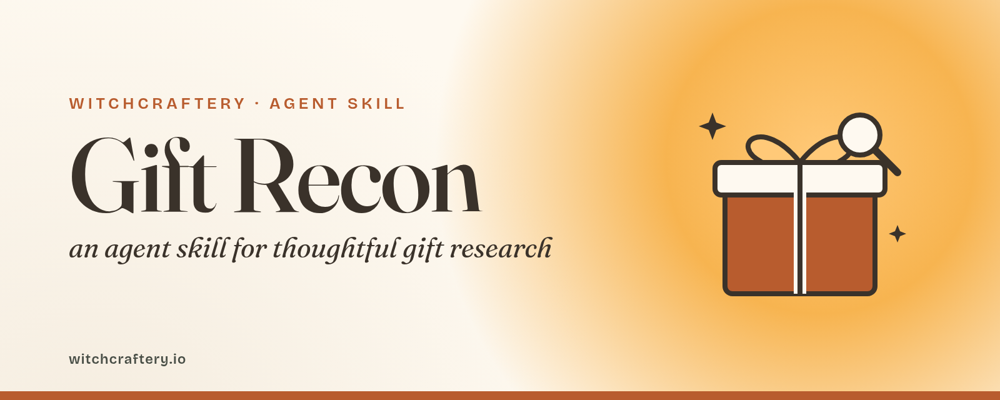

# Gift Recon

**An agent skill for thoughtful gift research.** Give your AI agent a messy brain dump about someone you love, and it comes back with a sharp recipient profile, a verified and scored shortlist of products, experiences, local events, and keepsakes, plus one confident pick: **The One**.

It does the research. You do the buying.

## What it does
- **Asks just enough:** who it's for, the occasion, the budget, the deadline, and the destination city.
- **Builds a Recipient Gift Profile** with 3-5 "gift angles" that drive the search.
- **Searches broadly:** hobby gear, experiences, local concerts and events, custom keepsakes, shared time, and the tabs you already have open.
- **Verifies everything:** a live link, the current price, availability, and an arrival estimate checked against your deadline (On time, Tight, Late, or Unknown).
- **Handles late gifts gracefully:** if the perfect gift arrives late, it drafts a day-of card so there's still something to hand over.
- **Scores with a fixed rubric:** Fit 40%, Uniqueness 25%, Practicality 20%, Confidence 15%.
- **Doesn't repeat itself:** follow-up rounds exclude every earlier idea.
- **Saves privately** to a "Gifting Recon" folder in your Drive or Documents.

## Example prompt
```
Use the gift-recon skill. My aunt turns 60 next month. She's a retired science
teacher who birdwatches, bakes sourdough, and still talks about a 1985 road trip
to the Grand Canyon. Budget $150, ships to Tucson, AZ. A little late is OK.
```
Follow-up: `Run another Gift Recon round. Skip everything from round 1, and lean into experiences.`

## Output format
1. **The One:** name, price, arrival, link, and why it wins (plus a runner-up and an on-time backup)
2. **Recipient Gift Profile**
3. **Gift Concept Candidates**

| Rank | Idea | Lane | Retailer/Venue | Price | Arrival | Verified | Score | Why |
|---|---|---|---|---|---|---|---|---|
| 1 | Guided dawn birding walk + field journal | Experience | Local Audubon chapter | $95 | On time (voucher) | Yes | 8.9 | Her favorite hobby, made into a morning out |

4. **Day-of plan + card text** (for late items or experiences)
5. **Excluded repeats** (follow-up rounds)
6. **Caveats**

## Install
The skill is a single `SKILL.md` file with YAML frontmatter, the format used by Claude Code, Cursor, and other agents that support skills.

```bash
git clone https://github.com/witchcraftery/gift-recon.git
# Claude Code (personal skills)
mkdir -p ~/.claude/skills && cp -r gift-recon ~/.claude/skills/
# Cursor / other agents: put it in your project's or user's skills folder, e.g.
mkdir -p .cursor/skills && cp -r gift-recon .cursor/skills/
```
No skills support? Paste the contents of `SKILL.md` into your agent's custom instructions or project rules. Web browsing works best. Google Drive access is optional, for saving results.

## Guardrails
- **Never buys, books, or checks out.** It can walk you through a checkout only when you ask, and you press the button.
- **Never contacts anyone,** including the recipient, sellers, or venues. It drafts; you send.
- **Privacy first:** recipient details stay in the task and your private folder. It never posts, follows, likes, or adds to wishlists.
- **Honest:** unverified prices or dates are labeled, never invented.
- Prices change. Always double-check before paying.

## License
MIT. See [LICENSE](LICENSE). *(The MIT choice is the author's default assumption for this release.)*

## Credits
Skill created by Nick Wichman - https://witchcraftery.io

*Witchcraftery: the study of making magic from anything.*
